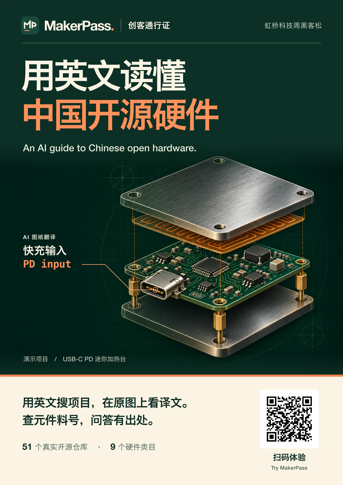

# MakerPass

**Chinese open hardware, in English.** MakerPass helps makers find projects, read translated schematic labels, look up component part numbers and check the sources behind build answers.

[View the poster](https://sean145238-bit.github.io/makerpass-poster/) · [Download the A3 poster (PNG, 300 dpi)](./makerpass-poster.png) · [Try the live demo](https://sean145238-sean.ms.show/)

